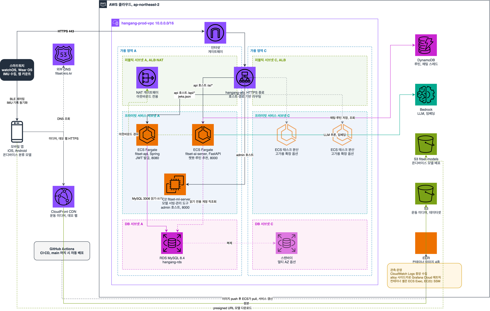
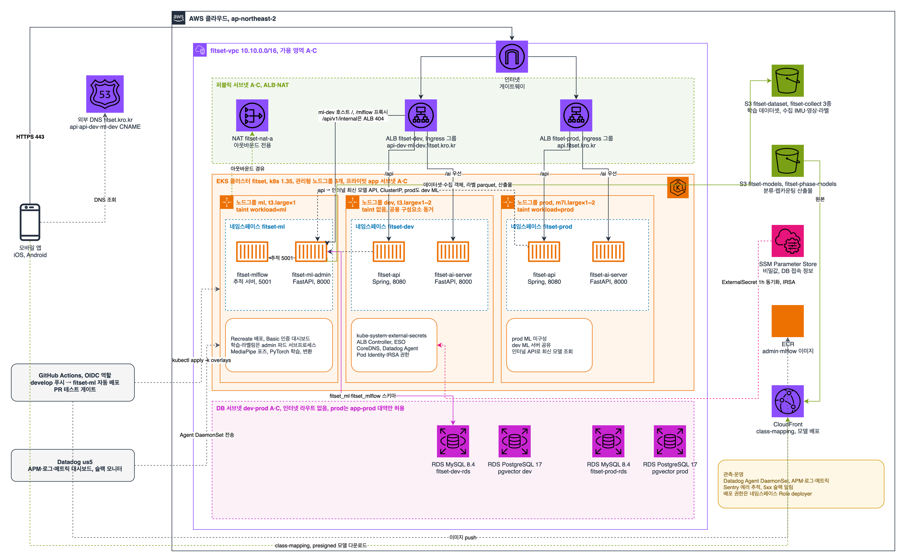
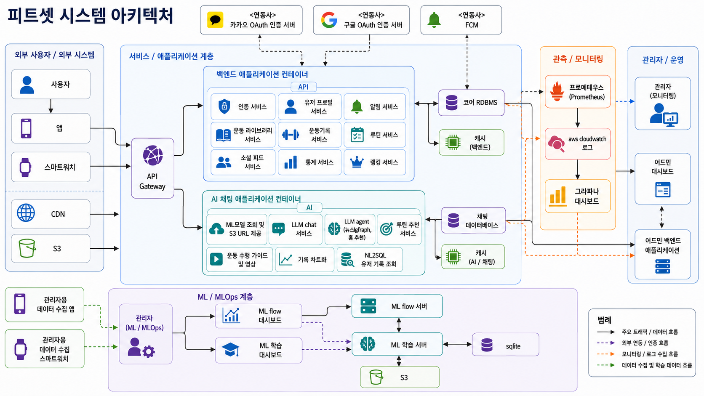
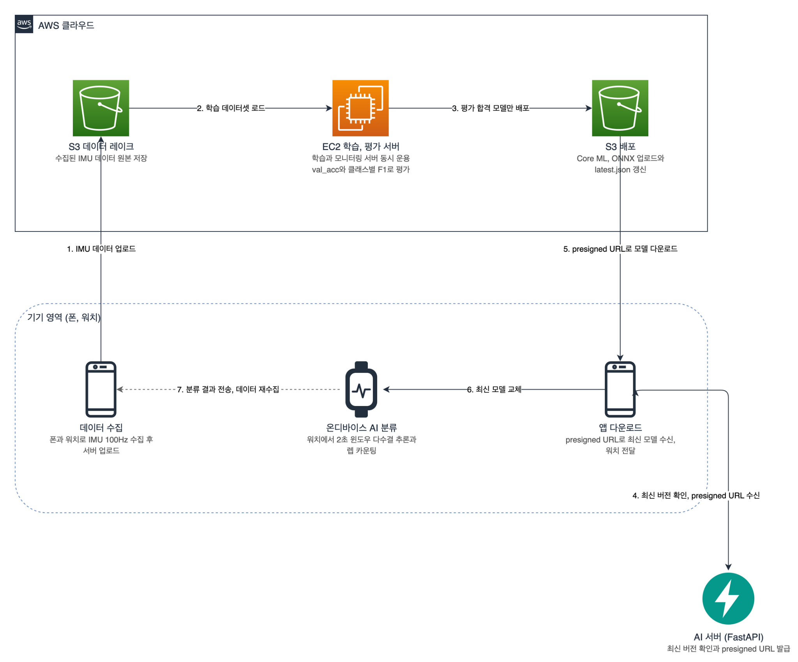
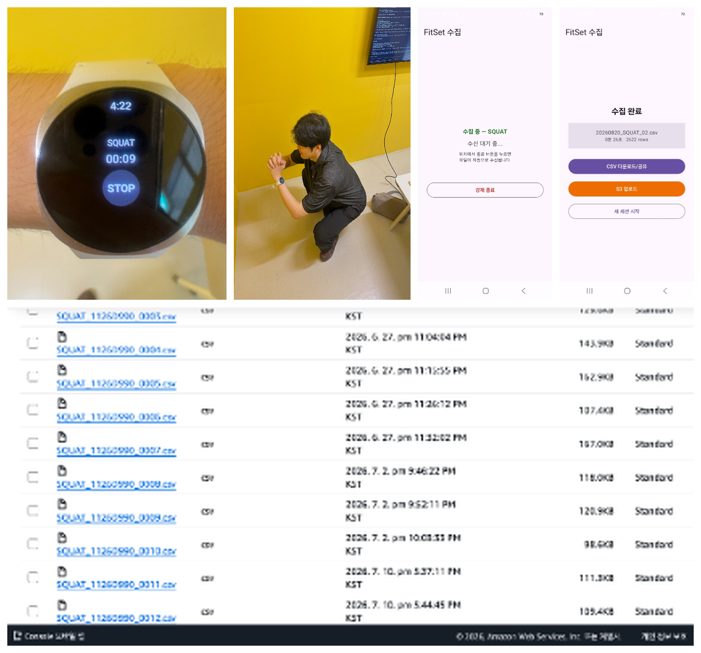
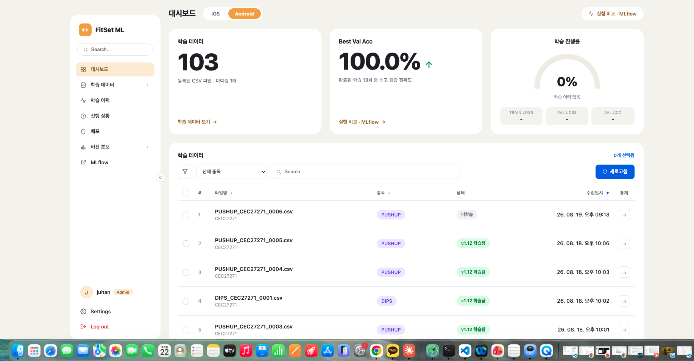
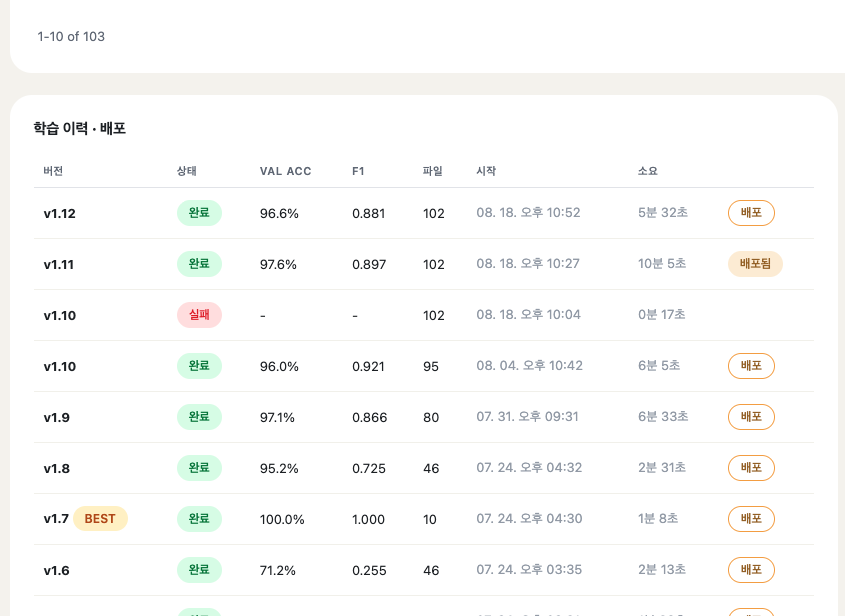

# FitSet ML Server

[Google Play에서 FitSet 다운로드](https://play.google.com/store/apps/details?id=com.teamhangang.fitset&hl=ko)

스마트워치 IMU 시계열로 운동 종목을 분류하는 온디바이스 모델의 데이터 수집, 학습, 평가, 변환, 배포 전 과정을 담당하는 ML 서버입니다.

## 클라우드 아키텍처

## 쿠버네티스 구성, EKS

## 시스템 아키텍처

## 기술 스택

| 구분 | 기술 |
|------|------|
| 서버 | Python, FastAPI |
| ML | PyTorch, MLflow, Core ML, ONNX, MediaPipe |
| DB | MySQL(RDS), SQLModel, Alembic |
| 인프라 | EKS, ALB Controller, External Secrets, Route 53, VPC, NAT Gateway, S3, CloudFront, SSM |
| 배포 | Docker, ECR, Kustomize, GitHub Actions |
| 관측 | Datadog, Slack |

## 모델 배포 생애주기

## 데이터 실수집

## 모델 성능

| 측정 항목 | 수치 | 측정 항목 | 수치 | 측정 항목 | 수치 |
|------|------|------|------|------|------|
| val_accuracy | 0.9596 | f1_사레레 | 1.0000 | f1_벤치프레스 | 0.8889 |
| test_accuracy | 0.9293 | f1_휴식 | 0.9536 | f1_머신 플라이 | 0.8333 |
| f1_전체 | 0.9209 | f1_오버헤드 프레스 | 0.8750 | f1_힙쓰러스트 | 1.0000 |
| f1_스쿼트 | 1.0000 | f1_바벨로우 | 0.8571 | f1_시티드 로우 | 0.8000 |
| f1_푸시업 | 0.9333 | f1_데드리프트 | 0.9167 | f1_딥스 | 1.0000 |
| f1_덤벨컬 | 0.9600 | f1_랫풀다운 | 0.8750 | | |

## 대시보드

## 코드 아키텍처

| 경로 | 역할 |
|------|------|
| app/main.py | 앱 조립, 미들웨어, 헬스체크 |
| app/deps.py | traceId, 플랫폼 검증, 세션 |
| app/mlflow_proxy.py | MLflow UI·API 프록시 |
| app/core/ | 설정, DB 엔진, S3, Basic 인증, 기준 모델 |
| app/data/ | 학습 데이터셋 목록, 통계, 어드민 업로드 |
| app/exercises/ | 종목 마스터, class-mapping 시드 |
| app/graph/ | 학습 CSV 6축 파형 |
| app/labeling/ | 수집 파일 업로드, MediaPipe 구간 라벨링 |
| app/phase/ | 종목별 렙카운팅 모델 학습, 추론, 배포 |
| app/training/ | 분류 모델 학습, MLflow 이력 |
| app/deployment/ | 환경별 배포 이력, 인터널 최신 모델 |
| app/motions/ | 45종목 판정 신호 |
| app/worker/ | 모델 정의, 전처리, Core ML·ONNX 변환 |
| app/static/ | 관리 대시보드 |
| alembic/ | MySQL 마이그레이션 |
| deploy/k8s/ | Kustomize base, dev 오버레이 |
| mlflow/ | MLflow 서버 이미지 |
| scripts/ | 버킷 초기화, 마이그레이션 |
| tests/ | API별 단위, 통합 테스트 |

| 층 | 역할 |
|------|------|
| router | HTTP 라우팅, 형식 검증, 응답 직렬화 |
| service | 유스케이스 조율 |
| domain | 순수 업무 규칙 |
| repository | MySQL, S3, MLflow 접근 |
| core | 공유 인프라 |

## 깃 컨벤션

| 항목 | 규칙 | 예시 |
|------|------|------|
| 커밋 메시지 | 타입(스코프): 요약 | fix(training): 업로드 미완료 파일 학습 제외 |
| 커밋 타입 | feat, fix, docs, test, refactor, ci, chore | |
| 브랜치 | 타입/케밥 케이스 | feat/per-file-time-split |
| 이슈 연결 | 제목 끝 (#이슈번호) | feat: MLflow UI 프록시 노출 (#33) |
| PR | 템플릿 작성, 요약, API 변경, 결정과 근거, 테스트 | |
| 머지 | develop 머지 시 fitset-ml 자동 배포 | |
